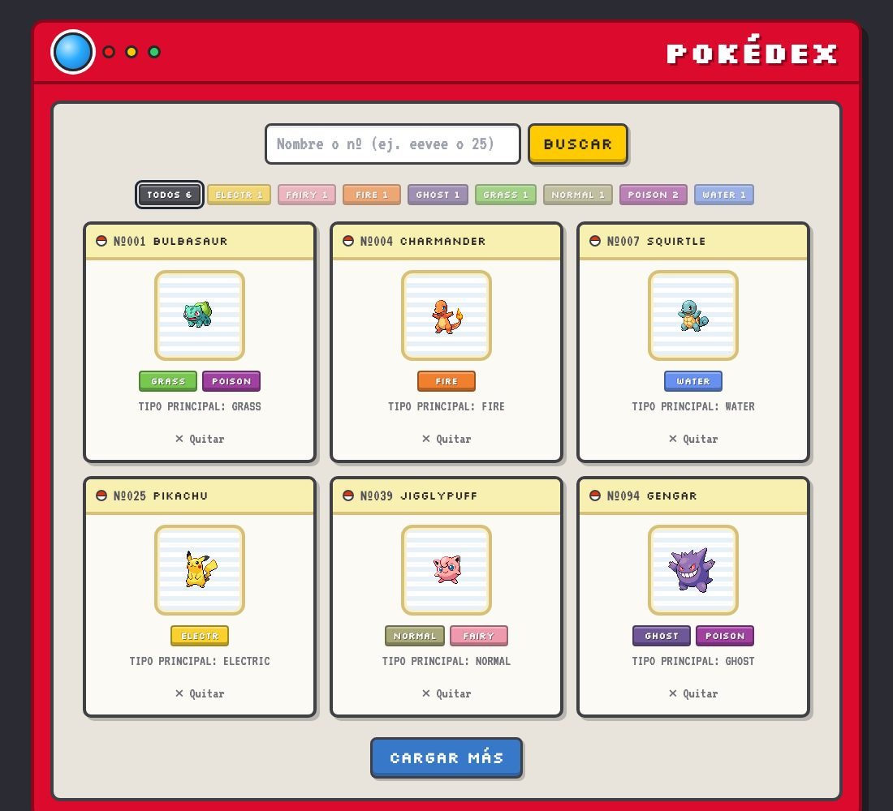
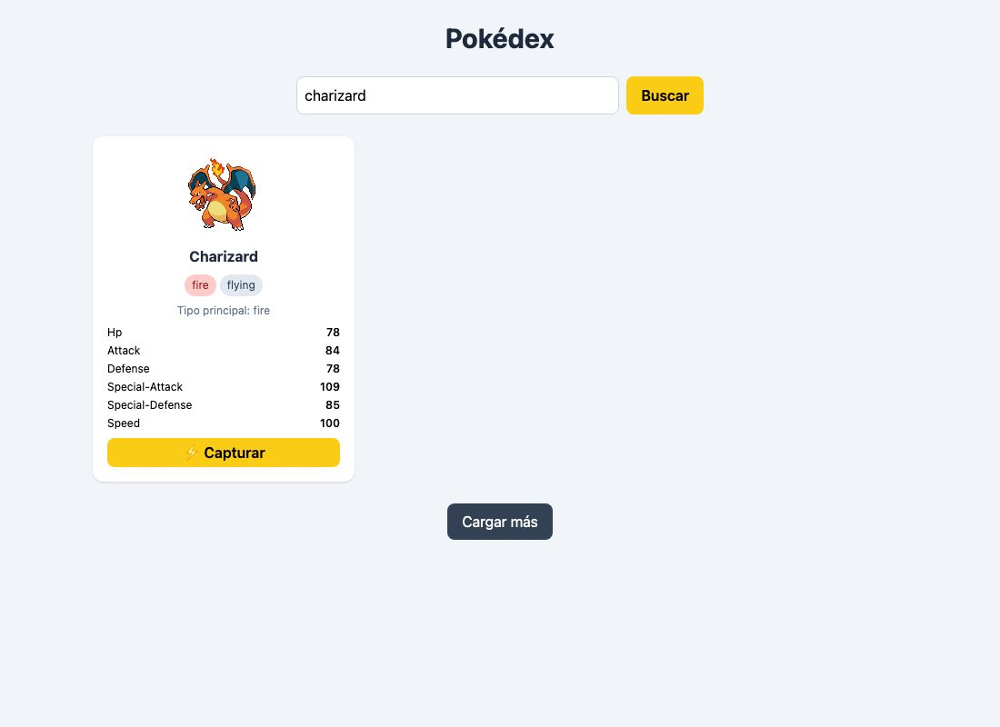

# Pokédex

Buscador de Pokémon que consume la [PokeAPI](https://pokeapi.co/). Carga una rejilla inicial, permite buscar cualquier Pokémon por nombre o número, ver sus estadísticas y **capturarlo** en tu colección. Maneja los errores (Pokémon que no existe, sin conexión) sin romperse.

## Demo

🔗 [Ver en GitHub Pages](https://naaria.github.io/pokedex/)



## Cómo usarlo

1. Abre el sitio desplegado: la rejilla carga 6 Pokémon desde la API.
2. Escribe un **nombre o número** (ej. `charizard` o `25`) y presiona **Buscar** o **Enter**.
3. En el resultado verás sus estadísticas; presiona **⚡ Capturar** para sumarlo a tu Pokédex.
4. Usa **Cargar más** para traer la siguiente página de 12 Pokémon.
5. Usa **Quitar** en una tarjeta para sacarla de tu colección.



## Tecnologías

- **JavaScript** moderno: template literals, destructuring, spread, optional chaining (`?.`) y `??`
- **Asincronía:** `fetch`, `async/await`, `Promise.all`
- **Manejo de errores:** `try / catch / finally`, `throw new Error`, `response.ok`
- **Tailwind CSS** (Play CDN)
- **[PokeAPI](https://pokeapi.co/)** — API pública, sin registro ni clave

## Funcionalidades por laboratorio

| Lab | Qué agrega |
| --- | --- |
| **C09** | Rejilla generada desde datos con el patrón *render* (`createElement` + `appendChild`), badges de tipo con `.map().join()`, imagen de respaldo con `??` y filtro en vivo |
| **C10** | Datos reales con `fetch` y Promesas, función adaptadora (`adaptarPokemon`) y carga en paralelo con `Promise.all` |
| **C11** | Carga con `async/await`, búsqueda en la API, botón **Capturar** sin duplicar (`.some`), estadísticas y paginación con `?limit` y `?offset` |
| **C12** | Errores y estados: `try/catch/finally`, `response.ok`, spinner (`#spinner`), mensajes de error (`#mensaje`) y botón **Reintentar** |

Logros opcionales implementados: color de badge por tipo, búsqueda por número, botón Quitar, spinner animado, botón Reintentar y "no encontrado" distinto de un error.

## Historias de usuario del proyecto

Cada historia se desarrolló en su propia rama y se integró a `main` con un Pull Request.

### HU-A: Estadísticas con barras (`feature/hu-barras-stats`)

Como entrenador, quiero ver las estadísticas del Pokémon que busqué como barras de colores para comparar de un vistazo qué tan fuerte es antes de capturarlo.

**Criterios de aceptación**
- El resultado de búsqueda muestra las 6 estadísticas con su nombre en español (PS, Ataque, Defensa, At. especial, Def. especial, Velocidad) y su valor numérico.
- Cada barra es proporcional al valor sobre el máximo posible (255) y cambia de color según el nivel: rojo (< 50), amarillo (50–89), verde (≥ 90).
- Se muestra el total de estadísticas base.
- Accesibilidad: el número siempre está escrito junto a la barra, así la información no depende solo del color; la barra es decorativa (`aria-hidden`).

**Implementación:** `crearBarrasStats(stats)` usa `.map()` para crear cada fila, `.reduce()` para el total y `??` para los nombres que no estén traducidos. `crearTarjeta` no cambia: las barras se agregan al nodo solo en el resultado de búsqueda.

## Manejo de errores y estados

| Situación | Qué ve el usuario |
| --- | --- |
| Buscando o cargando | Spinner animado en `#spinner` |
| Pokémon que no existe (404) | Aviso neutro en la rejilla: *🔍 No se encontró "pikachuu"* |
| Sin conexión | Mensaje rojo en `#mensaje` + botón **Reintentar** |
| Error del servidor (500…) | Mensaje rojo con el código + **Reintentar** |
| Falla la carga inicial | *No se pudo cargar la Pokédex.* + **Reintentar** |

## Decisiones técnicas

- **¿Por qué revisar `response.ok`?** `fetch` solo falla si no hay red. Un 404 o un 500 llegan como respuestas "exitosas", así que hay que revisarlas a mano y decidir qué hacer.
- **"No encontrado" no es un error.** Ante un 404, `obtenerPokemon` devuelve `null` en vez de lanzar: la búsqueda funcionó, solo que no hay resultado. Así se separa "no hay nada" (aviso neutro) de "algo se rompió" (mensaje rojo con Reintentar).
- **¿Por qué `finally`?** El spinner se oculta en `finally` porque ese bloque corre siempre, con éxito o con error. Si se ocultara al final del `try`, un error lo dejaría girando para siempre.
- **Una función adaptadora.** `adaptarPokemon` traduce el JSON anidado de la API a `{ nombre, imagen, tipos, stats }`. Por eso `crearTarjeta` y `render` de C09 no cambiaron aunque la fuente de datos sí.
- **Texto del usuario con `textContent`.** Lo que se escribe en el buscador se muestra con `textContent`, así nunca se interpreta como HTML.
- **Un commit por historia de usuario.** Cada lab se desarrolló en su rama (`lab10-api`, `lab11-async`, `lab12-errores`) y se integró a `main` con un Pull Request.

## Estructura

```
pokedex/
├── index.html      # estructura + Tailwind por CDN
├── js/
│   └── app.js      # datos, render, API, búsqueda y manejo de errores
├── docs/           # capturas para este README
└── README.md
```
